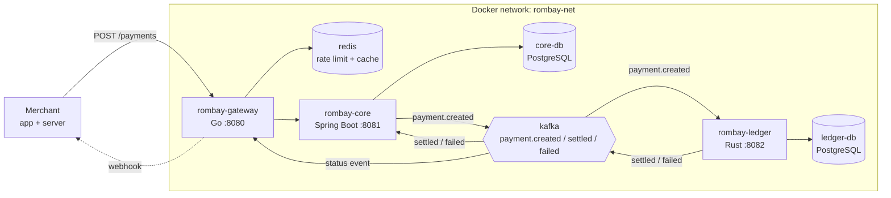
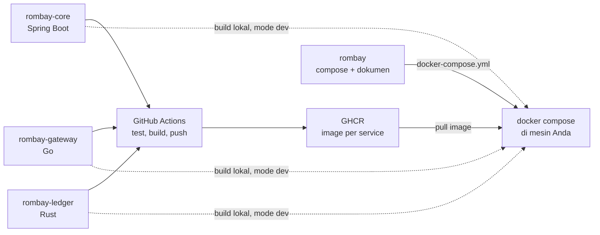
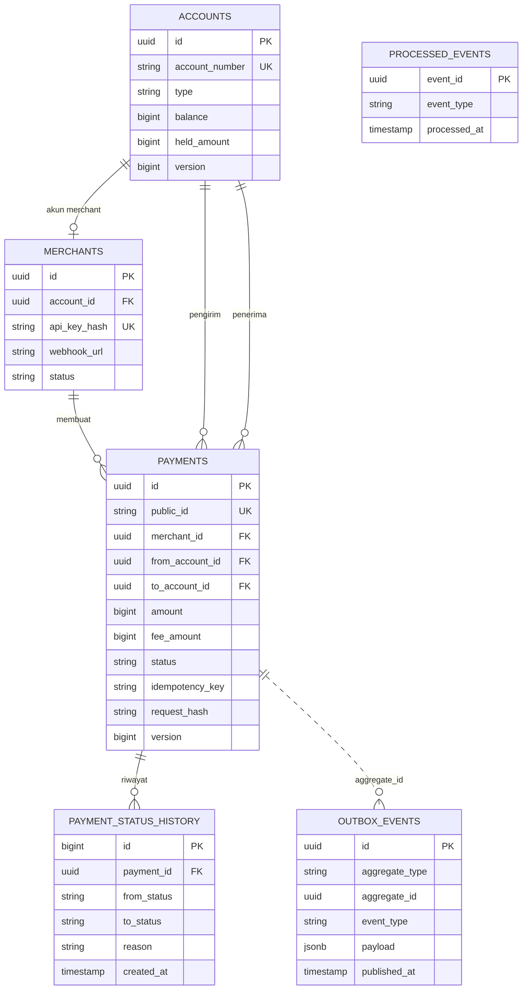
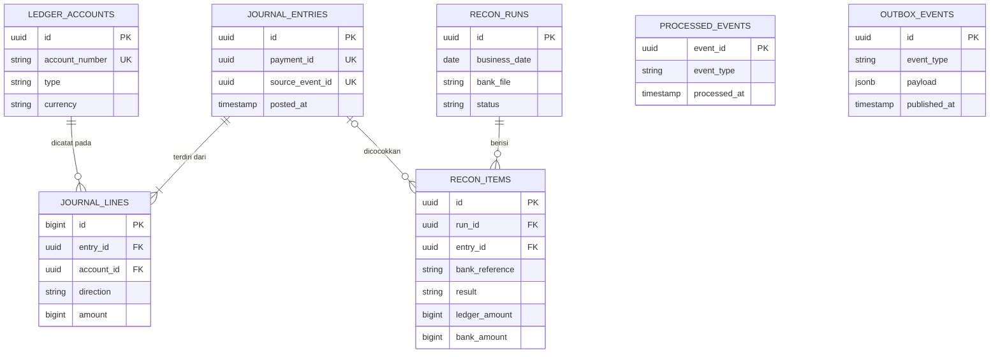
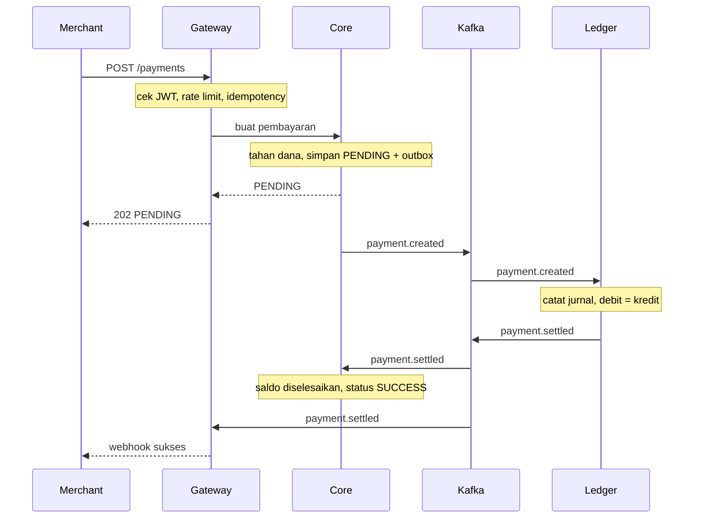
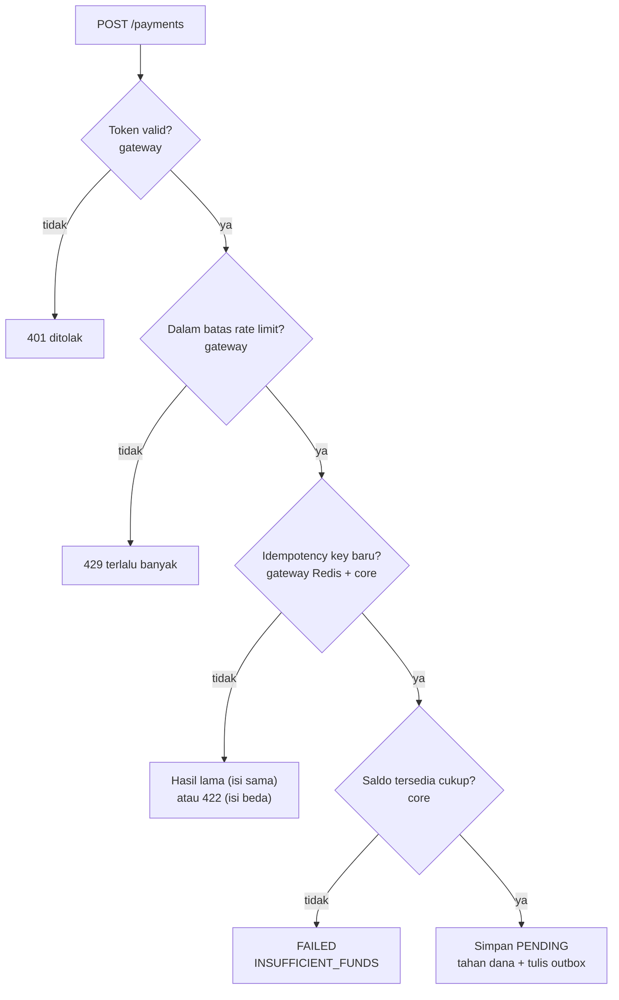
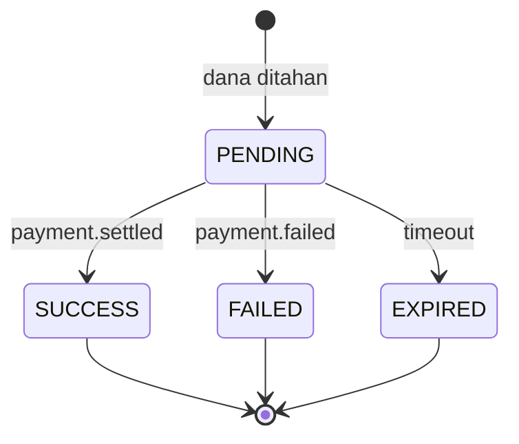

# Arsitektur Rombay

Dokumen ini berisi diagram arsitektur, relasi tabel, dan alur proses Rombay. Semua diagram memakai Mermaid sehingga dirender langsung oleh GitHub dan ikut versi kode.

Daftar isi:

1. [Arsitektur runtime](#1-arsitektur-runtime)
2. [Dari repo ke container](#2-dari-repo-ke-container)
3. [Relasi tabel rombay-core](#3-relasi-tabel-rombay-core)
4. [Relasi tabel rombay-ledger (usulan)](#4-relasi-tabel-rombay-ledger-usulan)
5. [Alur pembayaran sukses](#5-alur-pembayaran-sukses)
6. [Jalur keputusan request pembayaran](#6-jalur-keputusan-request-pembayaran)
7. [Siklus status pembayaran](#7-siklus-status-pembayaran)

---

## 1. Arsitektur runtime

Hanya `rombay-gateway` yang terbuka ke luar. Service lain hanya dapat dijangkau lewat network internal `rombay-net`. Garis putus-putus adalah webhook ke merchant.

Core juga membaca event hasil dari ledger untuk menyelesaikan status dan saldo, sedangkan gateway membacanya untuk mengirim webhook.

---

## 2. Dari repo ke container

Setiap repo service punya CI sendiri yang menghasilkan image di GHCR. Repo hub `rombay` hanya berisi orkestrasi. Pada mode dev, compose membangun langsung dari folder repo di sebelahnya.

---

## 3. Relasi tabel rombay-core

Skema lengkap ada di `rombay-core/src/main/resources/db/migration/V1__init.sql`. Garis putus-putus adalah hubungan logis tanpa foreign key.

| Tabel | Kegunaan |
|---|---|
| `accounts` | Saldo operasional (`balance`) dan dana tertahan (`held_amount`) |
| `merchants` | Identitas pemanggil API dan konfigurasi webhook |
| `payments` | Inti transaksi. Menunjuk ke satu merchant dan dua akun (pengirim dan penerima) |
| `payment_status_history` | Jejak audit setiap perubahan status |
| `outbox_events` | Antrean event ke Kafka. Terhubung ke pembayaran lewat `aggregate_id` tanpa foreign key |
| `processed_events` | Penanda event masuk yang sudah diproses |

---

## 4. Relasi tabel rombay-ledger (usulan)

Skema ledger belum difinalkan. Diagram ini adalah usulan awal untuk Fase 3.

Ide utama:

- Satu pembayaran menghasilkan satu `journal_entries` (`payment_id` unik) dengan minimal dua `journal_lines`. Kolom `direction` bernilai `DEBIT` atau `CREDIT`, dan total debit harus sama dengan total kredit sebelum ditulis.
- `source_event_id` yang unik mencegah event Kafka yang sama dicatat dua kali.
- Rekonsiliasi dipisah menjadi `recon_runs` (satu eksekusi per hari) dan `recon_items` (hasil per transaksi: cocok, hilang di bank, hilang di ledger, atau nominal berbeda).

---

## 5. Alur pembayaran sukses

Merchant menerima `202 PENDING` jauh sebelum ledger selesai. Hasil akhir datang lewat webhook, atau lewat `GET /payments/{id}` jika merchant ingin mengecek sendiri.

---

## 6. Jalur keputusan request pembayaran

Pemeriksaan diurutkan dari yang paling murah ke yang paling mahal, sehingga request yang salah ditolak sedini mungkin tanpa membebani core.

---

## 7. Siklus status pembayaran

PENDING dapat berakhir di tiga status, dan ketiganya final.

Efek tiap transisi pada kolom `accounts`:

| Transisi | Akun pembeli | Akun merchant dan fee | Event |
|---|---|---|---|
| Dibuat (PENDING) | `held_amount` naik | tidak berubah | `payment.created` |
| SUCCESS | `balance` dan `held_amount` turun sebesar `amount` | `balance` naik (merchant: `amount - fee`, akun fee: `fee`) | `payment.settled` |
| FAILED | `held_amount` turun (dana dilepas) | tidak berubah | `payment.failed` |
| EXPIRED | `held_amount` turun (dana dilepas) | tidak berubah | `payment.expired` (belum ada di kontrak) |

### Hal yang masih terbuka

- Job yang menandai PENDING lama menjadi EXPIRED belum didesain. Indeks `idx_payments_pending` di migrasi sudah disiapkan untuk itu.
- Event `payment.expired` perlu ditambahkan ke kontrak di `docs/events/`. Ledger tidak perlu mencatat apa pun untuk status ini karena dana tidak pernah berpindah.