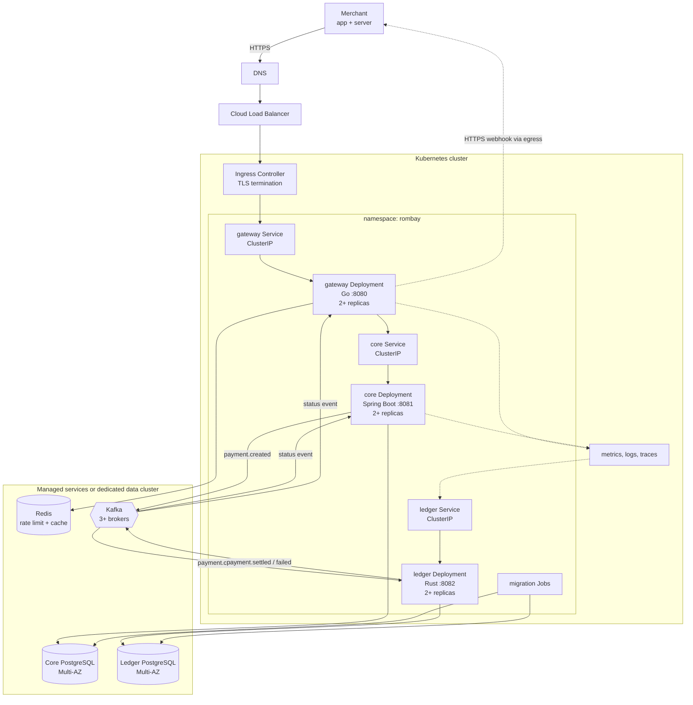
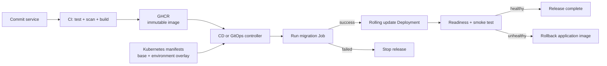

# Arsitektur Kubernetes Rombay

Dokumen ini menerjemahkan arsitektur runtime Rombay ke Kubernetes. Rancangannya provider-neutral dan memisahkan keputusan yang wajib untuk semua environment dari pilihan implementasi yang bergantung pada cloud atau platform.

Daftar isi:

1. [Prinsip desain](#1-prinsip-desain)
2. [Arsitektur runtime](#2-arsitektur-runtime)
3. [Pemetaan komponen ke resource Kubernetes](#3-pemetaan-komponen-ke-resource-kubernetes)
4. [Jaringan dan batas akses](#4-jaringan-dan-batas-akses)
5. [Skalabilitas dan high availability](#5-skalabilitas-dan-high-availability)
6. [Konfigurasi dan secrets](#6-konfigurasi-dan-secrets)
7. [Database dan migrasi](#7-database-dan-migrasi)
8. [Observability](#8-observability)
9. [Alur deployment](#9-alur-deployment)
10. [Environment](#10-environment)
11. [Keputusan yang belum final](#11-keputusan-yang-belum-final)

---

## 1. Prinsip desain

- Hanya `rombay-gateway` yang menerima trafik dari luar cluster.
- `rombay-core` dan `rombay-ledger` hanya dapat diakses dari jaringan internal yang diizinkan.
- Image bersifat immutable dan menggunakan tag versi atau digest, bukan `latest`.
- Pod service bersifat stateless. State disimpan di PostgreSQL, Kafka, dan Redis.
- Database Core dan Ledger tetap terpisah agar kepemilikan data tidak bocor antarservice.
- Event diproses minimal sekali (*at-least-once*), sehingga consumer wajib idempoten.
- Production dijalankan lintas node dan, jika tersedia, lintas availability zone.
- Secret tidak disimpan di manifest atau repository Git.

---

## 2. Arsitektur runtime

Komponen stateful ditampilkan di luar namespace aplikasi karena pada production komponen tersebut disarankan memakai layanan terkelola atau cluster yang dioperasikan terpisah. Pada environment lokal atau non-production, komponen yang sama dapat dijalankan di dalam cluster.

Trafik request tetap mengikuti pola asynchronous: merchant menerima `202 PENDING`, sedangkan hasil akhir dikirim melalui webhook atau dibaca melalui endpoint status pembayaran.

---

## 3. Pemetaan komponen ke resource Kubernetes

| Komponen | Resource | Eksposur | Catatan |
|---|---|---|---|
| Gateway | `Deployment`, `Service`, `HorizontalPodAutoscaler`, `PodDisruptionBudget` | Ingress ke `Service` `ClusterIP` | Satu-satunya pintu masuk publik |
| Core | `Deployment`, `Service`, `HorizontalPodAutoscaler`, `PodDisruptionBudget` | Internal | Hanya Gateway dan consumer/event path yang relevan |
| Ledger | `Deployment`, `Service`, autoscaling berbasis lag, `PodDisruptionBudget` | Internal | Consumer Kafka; HTTP hanya untuk health dan metrics bila diperlukan |
| Migrasi Core | `Job` | Tidak diekspos | Dijalankan sekali sebelum rollout Core |
| Migrasi Ledger | `Job` | Tidak diekspos | Dijalankan sekali sebelum rollout Ledger |
| Konfigurasi | `ConfigMap` | Internal | Hanya nilai non-rahasia |
| Credential | `Secret` atau secret-store eksternal | Internal | Di-mount atau diinjeksi sebagai environment variable |
| Network boundary | `NetworkPolicy` | Internal | Default deny lalu allow per alur yang diperlukan |
| Availability | `PodDisruptionBudget`, topology spread | Internal | Menjaga replica tersebar dan tetap tersedia saat maintenance |
| Ingress | `Ingress` atau `Gateway API` | Publik | TLS, routing, dan limit ukuran request |

PostgreSQL, Kafka, dan Redis tidak harus berupa resource Kubernetes. Untuk production, layanan terkelola lebih disarankan agar backup, failover, patching, dan replikasi tidak menjadi tanggung jawab workload aplikasi.

---

## 4. Jaringan dan batas akses

Gunakan kebijakan `default-deny` untuk ingress dan egress di namespace `rombay`, lalu buka alur berikut secara eksplisit:

| Sumber | Tujuan | Keperluan |
|---|---|---|
| Ingress Controller | Gateway | Request API merchant |
| Gateway | Core | Pembuatan dan pembacaan pembayaran |
| Gateway | Redis | Rate limit, cache, dan idempotency |
| Gateway | Kafka | Membaca event status |
| Gateway | Internet | Mengirim webhook merchant melalui HTTPS |
| Core | Core PostgreSQL | Data akun dan pembayaran |
| Core | Kafka | Menerbitkan dan membaca event pembayaran |
| Ledger | Ledger PostgreSQL | Jurnal dan rekonsiliasi |
| Ledger | Kafka | Membaca `payment.created` dan menerbitkan hasil |
| Pod aplikasi | DNS cluster | Service discovery |
| Scraper observability | Pod aplikasi | Mengambil metrics |

Aturan tambahan:

- Gunakan TLS untuk trafik publik dan koneksi ke layanan data jika didukung.
- Batasi egress webhook melalui NAT atau egress gateway agar sumber IP dapat diaudit.
- Jangan mengekspos Service Core, Ledger, database, Kafka, atau Redis sebagai `LoadBalancer` atau `NodePort`.
- Terapkan autentikasi dan ACL Kafka per service. Core, Gateway, dan Ledger memakai principal berbeda.
- Gunakan akun database berbeda dengan hak akses minimum untuk runtime dan migrasi.

---

## 5. Skalabilitas dan high availability

### Workload stateless

- Mulai production dengan minimal dua replica untuk Gateway, Core, dan Ledger.
- Sebarkan replica ke node dan availability zone berbeda menggunakan topology spread constraints atau pod anti-affinity.
- Gunakan `PodDisruptionBudget` agar maintenance node tidak menghentikan seluruh replica sekaligus.
- Tetapkan `requests` dan `limits` CPU/memori dari hasil load test, bukan perkiraan permanen.
- Gunakan rolling update dengan `maxUnavailable: 0` untuk Gateway dan Core jika kapasitas cluster mencukupi.

### Autoscaling

- Gateway dan Core dapat memakai HPA berdasarkan CPU/memori, lalu ditingkatkan dengan metrik latency atau request rate.
- Ledger lebih tepat diskalakan berdasarkan Kafka consumer lag, misalnya melalui metrics adapter atau event-driven autoscaler.
- Jumlah replica consumer aktif tidak dapat melebihi jumlah partition topic yang dikonsumsinya. Partition Kafka harus dirancang bersama target concurrency.
- Scale-down consumer harus memberi waktu untuk graceful shutdown dan consumer-group rebalance.

### Komponen stateful

- PostgreSQL production menggunakan high availability lintas zone, backup terjadwal, point-in-time recovery, dan uji restore berkala.
- Kafka production menggunakan minimal tiga broker, replication factor yang memadai, dan `min.insync.replicas` agar kehilangan broker tidak menghilangkan event yang sudah diakui.
- Redis production menggunakan mode high availability atau layanan terkelola. Hilangnya cache tidak boleh merusak sumber kebenaran transaksi di Core.

---

## 6. Konfigurasi dan secrets

Pisahkan konfigurasi berdasarkan sifatnya:

| Jenis | Contoh | Penyimpanan |
|---|---|---|
| Konfigurasi publik internal | nama topic, port, log level | `ConfigMap` |
| Credential | password database, Kafka credential | secret manager eksternal atau `Secret` terenkripsi |
| Kunci aplikasi | JWT verification/signing key, webhook signing key | secret manager eksternal |
| Identitas workload | akses cloud API atau secret manager | workload identity, bukan static access key |

Setiap environment memiliki referensi secret sendiri. Manifest dasar tidak berisi nilai secret, sedangkan pipeline hanya mereferensikan nama atau versi secret.

Perubahan `ConfigMap` atau `Secret` yang harus memicu rollout dapat diikat melalui checksum annotation atau mekanisme deployment controller.

---

## 7. Database dan migrasi

- Core dan Ledger memakai instance atau database serta credential yang terpisah.
- Migrasi dijalankan sebagai `Job` sebelum Deployment baru menerima trafik.
- Job migrasi menggunakan image versi yang sama dengan release aplikasi agar skema dan kode tetap selaras.
- Deployment hanya dilanjutkan jika Job migrasi sukses.
- Migrasi harus backward-compatible selama rolling update karena pod versi lama dan baru dapat berjalan bersamaan.
- Runtime database user tidak diberi hak DDL; hak tersebut hanya dimiliki migration user.
- Kegagalan migrasi menghentikan rollout dan tidak otomatis mengembalikan skema. Perubahan destruktif memerlukan prosedur khusus.

Untuk development di cluster lokal, PostgreSQL dapat dijalankan sebagai `StatefulSet` dengan `PersistentVolumeClaim`. Pola ini bukan default production.

---

## 8. Observability

Setiap service menyediakan endpoint terpisah untuk:

- Liveness: proses masih hidup. Pemeriksaan ini tidak bergantung pada database atau Kafka agar gangguan dependency tidak menyebabkan restart massal.
- Readiness: pod siap menerima trafik atau memproses event.
- Startup: memberi waktu bagi service yang lambat mulai tanpa diganggu liveness probe.
- Metrics: metrik teknis dan bisnis tanpa data sensitif.

Sinyal minimum yang dikumpulkan:

| Sinyal | Contoh |
|---|---|
| Metrics | request rate, error rate, latency, pod restart, Kafka lag, outbox backlog, webhook retry |
| Logs | JSON terstruktur dengan `trace_id`, `payment_id`, event type, dan hasil proses |
| Traces | Merchant → Gateway → Core serta korelasi publish/consume Kafka |
| Alerts | error rate tinggi, latency memburuk, consumer lag, outbox tertahan, database saturation, webhook DLQ |

Jangan menulis JWT, API key, credential, payload sensitif, atau data pribadi ke log dan trace.

---

## 9. Alur deployment

Urutan release lintas service mengikuti kompatibilitas kontrak:

1. Rilis perubahan event atau API yang backward-compatible pada consumer terlebih dahulu.
2. Rilis producer yang mulai mengirim kontrak baru.
3. Pantau consumer lag, error, outbox, dan webhook selama rollout.
4. Hapus kompatibilitas lama hanya setelah semua consumer sudah berpindah.

Rollback image tidak selalu berarti rollback database. Karena itu perubahan skema menggunakan pola expand-and-contract.

---

## 10. Environment

Gunakan manifest dasar yang sama dengan overlay per environment, misalnya melalui Kustomize atau Helm values.

| Aspek | Development | Staging | Production |
|---|---|---|---|
| Namespace | `rombay-dev` | `rombay-staging` | `rombay-prod` |
| Replica | 1 | 1-2 | 2+ dan tersebar lintas zone |
| Data service | Boleh di dalam cluster | Menyerupai production | Managed atau dedicated HA cluster |
| Domain | Internal/lokal | Domain staging | Domain production |
| Autoscaling | Opsional | Diaktifkan untuk validasi | Wajib sesuai hasil load test |
| Backup | Opsional | Disarankan | Wajib dan diuji restore |

Production sebaiknya dipisahkan dari non-production setidaknya pada cluster atau account/project cloud untuk mengurangi blast radius. Pemisahan namespace saja bukan batas keamanan terkuat.

---

## 11. Keputusan yang belum final

Hal berikut perlu ditentukan sebelum manifest production dibuat:

- Platform target: GKE, EKS, AKS, atau Kubernetes mandiri.
- Ingress Controller atau implementasi Gateway API yang digunakan.
- PostgreSQL, Kafka, dan Redis akan managed atau dijalankan di dalam Kubernetes.
- Mekanisme deployment: pipeline langsung, Argo CD, atau Flux.
- Format packaging manifest: Kustomize atau Helm.
- Secret manager dan integrasinya dengan workload identity.
- Domain, sertifikat TLS, dan kebijakan egress webhook.
- Target SLO, traffic baseline, Kafka partition count, serta batas minimum/maksimum autoscaling.
