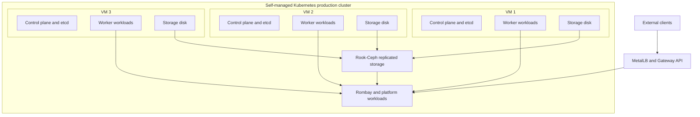
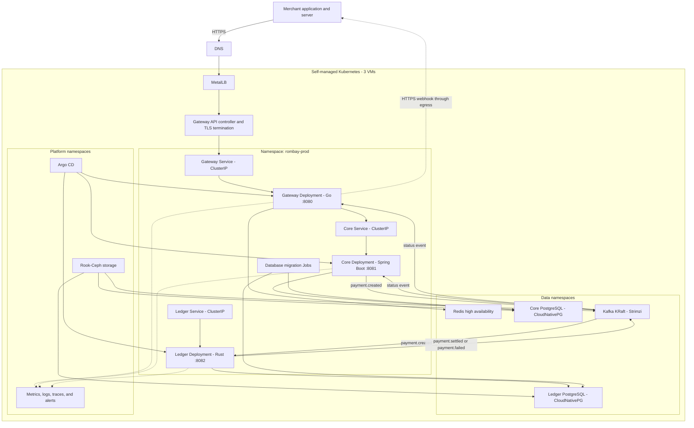

# Rombay Kubernetes Architecture

This document translates the Rombay runtime architecture into a self-managed Kubernetes design. The target is a single production cluster running on three VMs, with all application and data workloads hosted inside Kubernetes.

Table of contents:

1. [Design principles](#1-design-principles)
2. [Cluster topology](#2-cluster-topology)
3. [Runtime architecture](#3-runtime-architecture)
4. [Kubernetes resource mapping](#4-kubernetes-resource-mapping)
5. [Networking and access boundaries](#5-networking-and-access-boundaries)
6. [Scalability and high availability](#6-scalability-and-high-availability)
7. [Storage and stateful workloads](#7-storage-and-stateful-workloads)
8. [Configuration and secrets](#8-configuration-and-secrets)
9. [Database migrations](#9-database-migrations)
10. [Observability](#10-observability)
11. [Deployment flow](#11-deployment-flow)
12. [Backup and disaster recovery](#12-backup-and-disaster-recovery)
13. [Accepted risks](#13-accepted-risks)
14. [Open decisions](#14-open-decisions)

---

## 1. Design principles

- Only `rombay-gateway` accepts traffic from outside the cluster.
- `rombay-core` and `rombay-ledger` are reachable only through explicitly allowed internal paths.
- Application images are immutable and deployed by digest rather than `latest` tags.
- Application Pods are stateless; state is stored in PostgreSQL, Kafka, Redis, and persistent volumes.
- Core and Ledger keep separate PostgreSQL clusters and credentials.
- Events are processed at least once, so every consumer must be idempotent.
- All application, data, storage, observability, and delivery components run in Kubernetes.
- Three VMs form a highly available control plane and also run worker workloads.
- Production uses one permanent environment; there is no permanent development or staging namespace.
- Secrets are never committed to Git or embedded in Helm values.

---

## 2. Cluster topology

Each VM acts as a control-plane and worker node. This topology avoids additional machines, but it requires strict resource reservations so application workloads cannot starve the Kubernetes control plane or etcd.

The control plane, etcd, Kafka, PostgreSQL, Redis, and storage replicas must be distributed across different VMs. Losing one VM must not remove quorum or all replicas of a critical service.

---

## 3. Runtime architecture

The payment flow remains asynchronous. The merchant receives `202 PENDING` before Ledger finishes processing. The final result is delivered through a webhook or read through the payment status endpoint.

---

## 4. Kubernetes resource mapping

| Component | Kubernetes resources | Exposure | Notes |
|---|---|---|---|
| Gateway | `Deployment`, `Service`, `HorizontalPodAutoscaler`, `PodDisruptionBudget` | Public through Gateway API | The only public application entry point |
| Core | `Deployment`, `Service`, `HorizontalPodAutoscaler`, `PodDisruptionBudget` | Internal | Accessible from Gateway and required internal paths only |
| Ledger | `Deployment`, `Service`, lag-based autoscaling, `PodDisruptionBudget` | Internal | Kafka consumer; HTTP is used only for health and metrics when required |
| Core migration | Argo CD `PreSync` `Job` | None | Runs before the Core rollout |
| Ledger migration | Argo CD `PreSync` `Job` | None | Runs before the Ledger rollout |
| Core PostgreSQL | CloudNativePG `Cluster` | Internal | Separate primary and replicas with dedicated credentials |
| Ledger PostgreSQL | CloudNativePG `Cluster` | Internal | Isolated from the Core database |
| Kafka | Strimzi `Kafka`, `KafkaTopic`, and `KafkaUser` | Internal | KRaft mode with authentication and service-specific ACLs |
| Redis | Operator or Helm-managed HA resources | Internal | Rate limiting, cache, and idempotency assistance |
| Storage | Rook-Ceph operator and `CephCluster` | Internal | Provides replicated block and object storage |
| Configuration | `ConfigMap` | Internal | Non-sensitive values only |
| Credentials | `Secret` or in-cluster secret manager reference | Internal | Mounted or injected at runtime |
| Network boundaries | `NetworkPolicy` | Internal | Default deny with explicit allow rules |
| Availability | `PodDisruptionBudget`, topology spread, anti-affinity | Internal | Spreads replicas across all three VMs |
| Public routing | Gateway API resources | Public | TLS, routing, and request size limits |
| Delivery | Argo CD `Application` and `AppProject` | Internal | Reconciles Git desired state into the cluster |

Stateful platforms are managed through operators rather than handwritten application `StatefulSet` resources wherever a mature operator is selected.

---

## 5. Networking and access boundaries

Apply default-deny ingress and egress policies, then allow only these required paths:

| Source | Destination | Purpose |
|---|---|---|
| Gateway API controller | Gateway | Merchant API requests |
| Gateway | Core | Create and read payments |
| Gateway | Redis | Rate limiting, cache, and idempotency |
| Gateway | Kafka | Consume payment status events |
| Gateway | Internet | Send merchant webhooks over HTTPS |
| Core | Core PostgreSQL | Account and payment data |
| Core | Kafka | Publish and consume payment events |
| Ledger | Ledger PostgreSQL | Journals and reconciliation data |
| Ledger | Kafka | Consume `payment.created` and publish results |
| Application Pods | Cluster DNS | Service discovery |
| Observability collectors | Application and data Pods | Collect metrics, logs, and traces |
| Argo CD | Kubernetes API | Reconcile declared resources |

Additional controls:

- Use TLS for public traffic and internal data connections where supported.
- Restrict webhook egress through a controlled egress path when a stable source address is required.
- Never expose Core, Ledger, PostgreSQL, Kafka, Redis, Rook-Ceph, or Argo CD through public `LoadBalancer` or `NodePort` services.
- Give Core, Gateway, and Ledger separate Kafka principals and minimum required ACLs.
- Use separate database identities for runtime access and schema migrations.
- Restrict the Kubernetes API endpoint to trusted administration networks.

---

## 6. Scalability and high availability

### Stateless workloads

- Run at least two Gateway and Core replicas when cluster capacity permits.
- Spread replicas across different VMs with topology spread constraints or pod anti-affinity.
- Use a `PodDisruptionBudget` so planned node maintenance cannot evict every replica simultaneously.
- Define CPU and memory requests and limits from measured workload data.
- Use rolling updates with `maxUnavailable: 0` only when enough spare capacity exists for an additional Pod.
- Reserve CPU and memory for the operating system, kubelet, control plane, and etcd on every VM.

### Autoscaling

- Gateway and Core can use HPA based on CPU and memory before adding request-rate or latency metrics.
- Ledger should scale from Kafka consumer lag through a metrics adapter or event-driven autoscaler.
- Active consumer replicas cannot exceed the number of partitions in the consumed topic.
- Consumer scale-down must allow graceful shutdown and consumer group rebalancing.
- Node capacity does not scale automatically; HPA limits must respect the fixed capacity of three VMs.

### Quorum-based components

- etcd must keep quorum across the three control-plane nodes.
- Kafka brokers and controllers must be distributed across the three VMs.
- PostgreSQL primary and replicas must not share the same VM when avoidable.
- Redis replicas and Sentinel or equivalent HA components must be spread across nodes.
- Rook-Ceph must use separate disks and failure-domain-aware replica placement.

---

## 7. Storage and stateful workloads

Rook-Ceph provides persistent block and object storage from disks attached to the three VMs.

Storage requirements:

- Use dedicated data disks rather than the operating system disk.
- Keep at least three storage failure domains, one per VM.
- Monitor disk latency, capacity, replication health, and recovery operations.
- Set capacity alerts before Ceph reaches a critical fullness threshold.
- Test one-node failure and recovery before treating the cluster as highly available.
- Protect control-plane and etcd I/O from storage-heavy application workloads.

PostgreSQL requirements:

- Run separate CloudNativePG clusters for Core and Ledger.
- Use multiple instances with automated failover.
- Spread instances across nodes and use dedicated PVCs.
- Enable continuous backup, WAL archiving, and point-in-time recovery where storage permits.
- Test restore procedures, not only backup creation.

Kafka requirements:

- Run Kafka in KRaft mode through Strimzi.
- Use replication and minimum in-sync replica settings that tolerate one node failure.
- Size partitions together with expected Ledger and Core consumer concurrency.
- Monitor under-replicated partitions, broker disk usage, and consumer lag.

Redis requirements:

- Use high availability with replicas and automatic failover.
- Enable persistence only where required by the selected idempotency and recovery model.
- Redis must not become the source of truth for payment balances or final transaction status.

---

## 8. Configuration and secrets

Separate configuration by sensitivity:

| Type | Examples | Storage |
|---|---|---|
| Non-sensitive configuration | Topic names, ports, log level | `ConfigMap` or Helm values |
| Credentials | Database passwords, Kafka credentials | Kubernetes `Secret` or in-cluster secret manager |
| Application keys | JWT verification or signing key, webhook signing key | In-cluster secret manager |
| Workload identity | Access between workloads and platform components | Kubernetes `ServiceAccount`, RBAC, and short-lived credentials |

Production manifests contain secret references, never secret values. The Git repository must not contain plaintext credentials, encoded secret payloads, or long-lived access tokens.

Use checksum annotations or a deployment controller mechanism when a configuration or secret reference change must trigger a rollout.

---

## 9. Database migrations

- Core and Ledger use separate databases and credentials.
- Migrations run as Argo CD `PreSync` Jobs before a new Deployment receives traffic.
- The migration Job uses the same image digest as the application release.
- The rollout continues only after the migration Job succeeds.
- Migrations remain backward-compatible while old and new Pods may run together.
- Runtime database users have no DDL privileges; only migration identities can change schemas.
- A failed migration stops the rollout and does not automatically revert the schema.
- Destructive schema changes require an expand-and-contract sequence across separate releases.

Application rollback and database rollback are different operations. Reverting an image digest must not be assumed to undo a schema change.

---

## 10. Observability

Every service provides separate endpoints for:

- Liveness: confirms the process is alive without depending on PostgreSQL or Kafka.
- Readiness: confirms the Pod can accept traffic or process events.
- Startup: gives slower services enough time to start before liveness checks begin.
- Metrics: exposes technical and business signals without sensitive data.

Minimum signals:

| Signal | Examples |
|---|---|
| Metrics | Request rate, error rate, latency, Pod restarts, Kafka lag, outbox backlog, webhook retries |
| Logs | Structured JSON with `trace_id`, `payment_id`, event type, and processing result |
| Traces | Merchant to Gateway to Core, plus Kafka publish and consume correlation |
| Platform health | Node pressure, etcd latency, Ceph health, PostgreSQL replication, Kafka replication, Redis failover |
| Alerts | High error rate, latency degradation, consumer lag, stuck outbox, storage pressure, database saturation, webhook DLQ |

Never write JWTs, API keys, credentials, sensitive payloads, or personal data to logs and traces.

---

## 11. Deployment flow

```mermaid
graph LR
  n1["Service source pull request"] --> n2["Test, scan, and review"]
  n2 --> n3["Merge into main"]
  n3 --> n4["Build image once"]
  n4 --> n5["Push immutable digest to GHCR"]
  n5 --> n6["Open image-only PR in rombay-kubernetes"]
  n6 --> n7["Helm, schema, and policy validation"]
  n7 --> n8["Auto-merge valid digest update"]
  n8 --> n9["Argo CD pulls desired state"]
  n9 --> n10["Run PreSync migration Job"]
  n10 -->|Success| n11["Rolling update"]
  n10 -->|Failure| n12["Stop rollout and alert"]
  n11 --> n13["Readiness and production smoke test"]
```

The source pull request is the human approval gate. The image-only deployment pull request may auto-merge after all required checks pass. Platform, storage, database, networking, and security changes always require human review.

Rollback uses a Git revert of the desired image digest. Do not run manual `helm rollback` for resources reconciled by Argo CD because the live state would diverge from Git.

See [Pipeline Architecture](pipeline-architecture.md) for the complete CI/CD design.

---

## 12. Backup and disaster recovery

The cluster requires separate backup procedures for:

- etcd snapshots and Kubernetes bootstrap configuration.
- Core and Ledger PostgreSQL base backups and WAL archives.
- Kafka data where retention and recovery requirements demand it.
- Persistent volume snapshots or file-level backups.
- Argo CD and platform custom resources, which should also be reproducible from Git.

A backup stored only in the same three-VM cluster does not protect against total cluster or site loss. If every component must remain Kubernetes-based, a second Kubernetes cluster in another failure domain is required for meaningful disaster recovery.

Restore exercises must verify recovery time and data integrity. A successful backup job alone is not evidence that recovery works.

---

## 13. Accepted risks

The three-VM, single-environment design accepts these constraints:

- There is no production-like environment before deployment.
- Application defects that pass CI reach production directly.
- Platform upgrades are first exercised on production.
- Control-plane, application, data, and storage workloads share the same three VMs.
- A single VM failure significantly reduces compute and storage headroom.
- A two-VM failure removes quorum from multiple critical components.
- Storage recovery can compete with application workloads for CPU, memory, disk, and network capacity.
- Backups inside the same cluster do not provide site-level disaster recovery.

Mitigations include strong CI integration tests, immutable images, manifest validation, resource reservations, topology constraints, readiness probes, observability, tested backups, and Git-based rollback.

---

## 14. Open decisions

The following decisions must be finalized before implementation:

- Kubernetes and operating system versions, including the upgrade policy.
- CNI and NetworkPolicy implementation.
- Gateway API controller and MetalLB configuration.
- Certificate management and DNS automation.
- Redis operator or Helm chart selection.
- In-cluster secret management implementation.
- CPU, memory, network, and disk capacity for each VM.
- Rook-Ceph disk layout, replication, and recovery settings.
- PostgreSQL instance counts and synchronous replication policy.
- Kafka broker, controller, partition, replication, and retention settings.
- Resource requests, limits, and replica targets for every component.
- SLOs, alert thresholds, and production smoke tests.
- Backup destination outside the production cluster failure domain.
