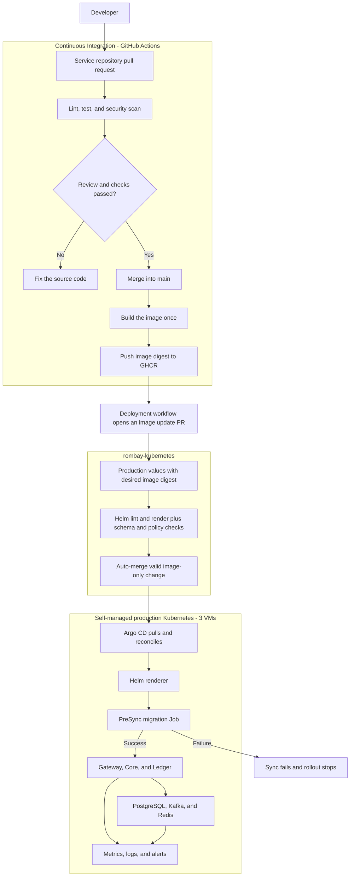
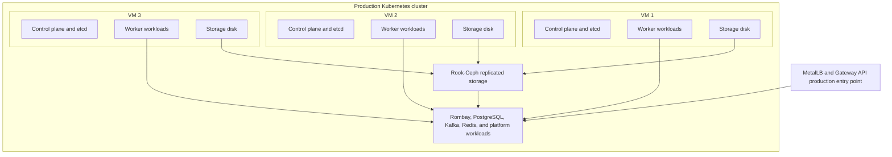
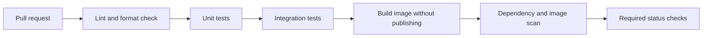
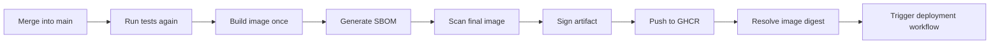
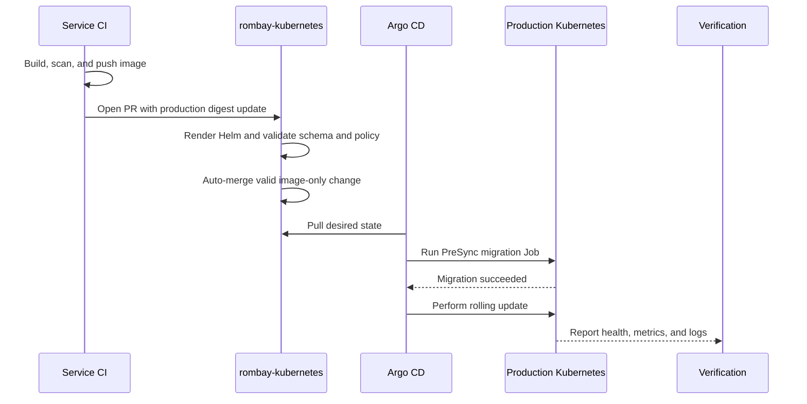

# Rombay Kubernetes Pipeline Architecture

This document describes the Rombay CI/CD pipeline for a single production environment running on a three-VM, self-managed Kubernetes cluster. There are no permanent development or staging environments.

Key decisions:

- Three VMs form one production Kubernetes cluster.
- Each VM acts as both a control-plane and worker node to avoid requiring additional VMs.
- All Rombay runtime components, PostgreSQL, Kafka, Redis, storage, observability, and delivery controllers run in Kubernetes.
- The application source pull request is the human approval gate before a release.
- After the source pull request is merged, the build and production deployment are automatic.
- The `rombay-kubernetes` repository is the source of truth for the production desired state.
- Helm only renders manifests; Argo CD pulls and applies them to the cluster.
- An image is built once and deployed by immutable digest.

GitHub and GHCR remain the source control, CI control plane, and container registry. Runtime workloads do not depend on managed Kubernetes, managed databases, managed Kafka, or managed Redis.

## 1. High-level architecture



There is no promotion service. The deployment workflow is a GitHub Actions job that uses a GitHub App to open a cross-repository pull request.

## 2. Three-VM cluster topology



The scheduler must spread service replicas and quorum-based components across different VMs using topology spread constraints, pod anti-affinity, and `PodDisruptionBudget` resources.

The three VMs must retain enough spare capacity to run critical workloads when one VM is unavailable. Replica counts alone do not provide high availability if the remaining two VMs cannot schedule the displaced Pods.

## 3. Repository responsibilities

| Repository | Responsibility |
|---|---|
| `rombay-gateway` | Go source, tests, Dockerfile, and Gateway image build |
| `rombay-core` | Spring Boot source, tests, database migrations, and Core image build |
| `rombay-ledger` | Rust source, tests, database migrations, and Ledger image build |
| `rombay-kubernetes` | Helm charts, production values, Argo CD Applications, platform operators, policies, and cluster configuration |

Application repositories do not store a production kubeconfig. The Kubernetes repository does not rebuild application images.

## 4. Repository structure

```text
rombay-kubernetes/
├── bootstrap/
│   ├── argocd/
│   └── root-application.yaml
├── cluster/
│   └── production/
├── platform/
│   ├── networking/
│   ├── certificates/
│   ├── storage/
│   ├── cloudnative-pg/
│   ├── strimzi/
│   ├── redis/
│   ├── observability/
│   └── backup/
├── charts/
│   ├── rombay-gateway/
│   ├── rombay-core/
│   └── rombay-ledger/
├── environments/
│   └── production/
│       ├── gateway-values.yaml
│       ├── core-values.yaml
│       └── ledger-values.yaml
├── policies/
├── scripts/
└── docs/
```

A chart per service does not turn the service into a Helm application. The chart only packages its Kubernetes resources, such as `Deployment`, `Service`, `HorizontalPodAutoscaler`, `PodDisruptionBudget`, and `NetworkPolicy`.

Stateful platform components are managed through operators and custom resources:

- CloudNativePG manages separate Core and Ledger PostgreSQL clusters.
- Strimzi manages Kafka, topics, users, and related credentials.
- Redis runs in a high-availability mode through the selected operator or chart.
- Rook-Ceph provides persistent volumes and object storage.

## 5. Service continuous integration

Each service has two primary workflows.

### Pull request



The source code pull request is the human control gate. It does not publish a release image or deploy anything.

### Merge into main



The manifest always uses a digest:

```text
ghcr.io/rombay-tbk/rombay-core@sha256:0123456789abcdef...
```

A tag may be added for readability, but it is not the identity of the artifact deployed to production.

## 6. Continuous delivery directly to production

After the image is published, the deployment workflow opens a pull request against `rombay-kubernetes`.

Example change:

```diff
 image:
   repository: ghcr.io/rombay-tbk/rombay-core
-  digest: sha256:old
+  digest: sha256:new
```

Complete flow:



The deployment pull request does not require a human reviewer when all of these conditions are met:

- Only the service image digest field changes.
- The digest belongs to an image in the `rombay-tbk` GHCR organization.
- The source commit passed CI and was merged.
- Helm lint and rendering succeed.
- The rendered manifests pass schema and policy validation.
- No plaintext secrets are present.
- All branch protection checks pass.

The GitHub App receives only enough access to create a branch, modify the allowed production values file, and open a pull request. It has no cluster administrator access.

## 7. Changes that must not auto-merge

The following changes still require human review:

- Kubernetes, Argo CD, operator, or CRD upgrades.
- PostgreSQL, Kafka, Redis, Rook-Ceph, and storage changes.
- Significant resource request or limit changes.
- Replica, autoscaling, PDB, or topology policy changes.
- Network policy, RBAC, secret management, and admission policy changes.
- Database migration strategy changes.
- Gateway API, TLS, DNS, and production traffic path changes.

This separation prevents the image release automation from introducing unrelated platform changes.

## 8. Argo CD and Helm

Argo CD is the only component that applies the desired state to the cluster. Its `Application` points to:

- The service chart.
- The production values file.
- The `main` branch of `rombay-kubernetes`.
- The production cluster and namespace.
- Automated sync and self-heal policies.

```text
charts/rombay-core/
        +
environments/production/core-values.yaml
        ↓
Argo CD renders with Helm
        ↓
Deployment + Service + HPA + PDB + NetworkPolicy
```

The pipeline does not run `kubectl apply` or `helm upgrade` against production. Cluster credentials remain with in-cluster delivery components and authorized operators.

Enable `prune` carefully. An image-only auto-merge must never delete a namespace, persistent volume, database, Kafka cluster, Redis cluster, or storage resource.

## 9. Database migrations

Core and Ledger run migrations through an Argo CD `PreSync` Job:

```text
desired image digest changes
    ↓
run migration Job
    ↓
did migration succeed?
    ├── no  → sync fails and rollout stops
    └── yes → start rolling update
```

Migration requirements:

- The migration Job uses the same image digest as the application.
- The runtime database user has no DDL privileges.
- Migrations remain backward-compatible with the previous Pods.
- A failed migration stops the rollout.
- An application rollback is not treated as a database rollback.
- Destructive changes use an expand-and-contract pattern across separate releases.

## 10. Rollout strategy

The baseline uses Kubernetes `RollingUpdate`:

- Gateway and Core have at least two replicas when capacity allows.
- Use `maxUnavailable: 0` when the cluster has room for an additional Pod during rollout.
- Readiness probes prevent Pods from receiving traffic before they are ready.
- Startup probes allow slower services enough startup time.
- Liveness probes only detect genuinely stuck processes.
- Pod replicas are spread across different VMs.
- A `PodDisruptionBudget` preserves availability during planned node drains.

Canary deployment and automatic rollback with Argo Rollouts can be added after production metrics and thresholds are stable. Canary is not a baseline release requirement.

## 11. Deployment verification

A release is successful only when:

- Argo CD reports `Synced` and `Healthy`.
- The migration Job has completed when the release contains a migration.
- The Deployment reaches its desired number of available replicas.
- All readiness probes pass.
- The production endpoint smoke test passes.
- Kafka consumer lag does not grow abnormally.
- Error rate, latency, outbox backlog, and webhook retries remain within limits.
- Nodes, storage, PostgreSQL, Kafka, and Redis remain healthy.

`Synced` alone is insufficient because manifests can match Git while the application is unhealthy.

## 12. Failure and rollback

If a migration Job or readiness check fails, Argo CD marks the application as `Degraded`, and the rollout is not considered complete. An alert must notify an operator.

The baseline rollback uses Git revert:

```text
deployment is unhealthy
    ↓
revert the digest commit in rombay-kubernetes
    ↓
merge the emergency change
    ↓
Argo CD reconciles the previous digest
    ↓
verify health and metrics
```

Do not run `helm rollback` manually for resources managed by Argo CD. That would diverge from Git and could be overwritten by self-healing.

Enable automatic rollback only after health signals are trustworthy. A false rollback triggered by noisy alerts can extend an incident.

## 13. Platform pipeline

Platform components do not use the application image auto-merge path. Operator and platform chart versions are updated through human-reviewed pull requests.

Bootstrap order:

```text
1. Run kubeadm on the three VMs
2. Configure the control-plane endpoint and CNI
3. Install Rook-Ceph and base storage
4. Install Argo CD once
5. Apply the root Application
6. Let Argo CD manage the platform and applications
```

Platform reconciliation order:

```text
1. CRDs and operators
2. Networking, certificates, and storage
3. PostgreSQL, Kafka, and Redis custom resources
4. Observability and backup
5. Gateway, Core, and Ledger
```

Because there is no staging environment, every platform upgrade requires a validated backup, compatibility checks, a maintenance window, and a rollback plan before merge.

## 14. Software supply chain security

- Workflows use explicit, minimum GitHub permissions.
- A GitHub App provides cross-repository access; avoid long-lived personal access tokens.
- The GitHub App token is short-lived and scoped to `rombay-kubernetes`.
- Images produce an SBOM, are scanned, and are signed before deployment.
- Admission policy can reject images from unapproved registries or signers.
- Secrets are never stored in plaintext Helm values or Git files.
- Argo CD uses read-only Git credentials when write access is unnecessary.
- Manual sync, override, and production access are restricted through audited RBAC.
- The image update bot cannot modify charts, platform configuration, policies, or secret references.

## 15. Branch and review policy

The `main` branch is the desired state consumed by Argo CD.

Policy for automatic image updates:

- The pull request must be created by the approved GitHub App.
- Only the related service digest file may change.
- All required checks must pass.
- Auto-merge is allowed without a human reviewer.
- Force push and branch deletion are disabled.

Policy for platform and manual configuration changes:

- A pull request is required.
- CODEOWNERS review is required.
- Database, Kafka, storage, RBAC, network, and production policy changes require human approval.
- Force push and ordinary user bypass are disabled.

## 16. Required workflows

| Repository | Workflow | Trigger | Output |
|---|---|---|---|
| Service | `ci.yml` | Pull request | Lint, test, scan, and required checks |
| Service | `release-image.yml` | Merge into `main` | Image digest, SBOM, and signature |
| Service | `deploy-production.yml` | Successful image release | Image-only PR against `rombay-kubernetes` |
| Kubernetes | `validate.yml` | Pull request | Helm render, schema, policy, and change-scope checks |
| Kubernetes | `auto-merge-image.yml` | Successful image-only checks | Merge the desired production digest |

Argo CD handles deployment after merge, so GitHub workflows do not need a production kubeconfig.

## 17. Accepted risks

A single cluster and environment reduce cost and pipeline complexity, but accept these risks:

- There is no production-like environment for pre-deployment validation.
- A defect that passes CI reaches production directly.
- Platform upgrades are first exercised on the production cluster.
- Applications and data share the same three-VM failure domain.
- Loss of the cluster or storage domain can stop the entire Rombay system.
- A backup stored in the same cluster does not protect against total cluster loss.

Mitigations include integration tests with temporary CI dependencies, manifest validation, immutable images, rolling updates, readiness probes, observability, backups, and Git-based rollback. Protection against total cluster loss still requires a backup copy in another failure domain.

## 18. Open decisions

The following decisions must be finalized before implementing the pipeline:

- GitHub-hosted runners or Actions Runner Controller in the cluster.
- GitHub App permissions and allowed paths for digest updates.
- Scanner, signer, SBOM format, and admission policy.
- Gateway API, CNI, MetalLB, and certificate management implementations.
- CPU, memory, and disk capacity for each VM.
- Replica targets and resource requests and limits for every component.
- Health thresholds, alert routing, and production smoke tests.
- Backup storage outside the production cluster failure domain.
